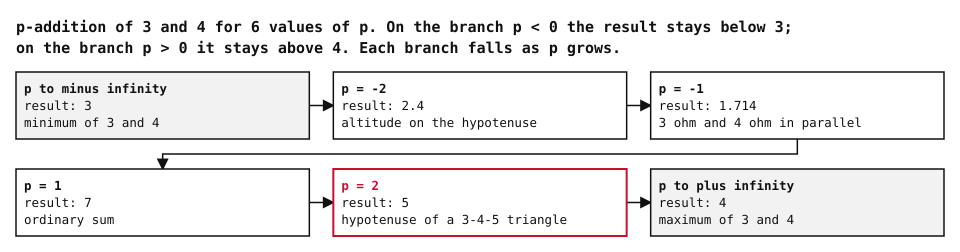
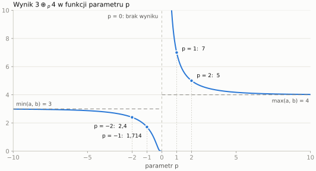

# New mathematical operations

[Polski](README.pl.md)

This repository collects mathematical operations that have applications in physics and engineering. Each operation has its own directory. The detailed documents are written in Polish.

| No. | Operation | Formula | Directory |
|---|---|---|---|
| 1 | p-addition (p-dodawanie) | $a \oplus_p b = (a^p + b^p)^{1/p}$ | [p-dodawanie](p-dodawanie/README.md) |





## Starting point

Each operation in the sequence "addition, multiplication, exponentiation" repeats the previous one:

- Repeated addition gives multiplication: $a \cdot n = a + a + \dots + a$ (n terms).
- Repeated multiplication gives exponentiation: $a^n = a \cdot a \cdot \dots \cdot a$ (n factors).

Exponentiation is not commutative: $2^3 = 8$, while $3^2 = 9$. It is not associative either: $(2^3)^2 = 64$, while $2^{(3^2)} = 512$. This repository describes operations that keep both properties.

## p-addition in short

One parameter $p$ replaces separate formulas. $p = 1$ gives the ordinary sum. $p = 2$ gives the hypotenuse of a right triangle and the combined standard uncertainty of independent quantities. $p = -1$ gives resistors in parallel and capacitors in series. For $p \to +\infty$ the result tends to the maximum, for $p \to -\infty$ to the minimum. The [p-dodawanie document](p-dodawanie/README.md) lists the sources and 10 properties.

## What the directory of one operation contains

Each directory has 5 parts:

1. A definition with a glossary.
2. Properties with tests.
3. Applications with sources.
4. Visualisations: figures and an interactive page.
5. Python code.

## Running the tests

```sh
cd p-dodawanie
python3 -m pytest -q test_pdodawanie.py
```

On 2026-11-15 all 39 tests passed.

## Text style

The Polish documents follow the rules of Polszczyzna Kontrolowana (controlled Polish): one term has one meaning, one formula takes one line, every number has a unit.

## License

MIT. See [LICENSE](LICENSE).
