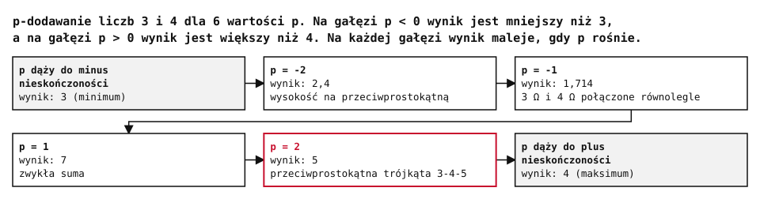
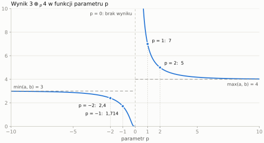

# Nowe działania matematyczne

[English](README.md)

Repozytorium zbiera działania matematyczne, które mają zastosowanie w fizyce i w technice. Każde działanie ma osobny katalog.

| Nr | Działanie | Wzór | Katalog |
|---|---|---|---|
| 1 | p-dodawanie | $a \oplus_p b = (a^p + b^p)^{1/p}$ | [p-dodawanie](p-dodawanie/README.md) |





## Punkt wyjścia

Każde działanie w ciągu „dodawanie, mnożenie, potęgowanie” jest powtórzeniem działania poprzedniego:

- Powtórzone dodawanie daje mnożenie: $a \cdot n = a + a + \dots + a$ (n składników).
- Powtórzone mnożenie daje potęgowanie: $a^n = a \cdot a \cdot \dots \cdot a$ (n czynników).

Potęgowanie nie jest przemienne: $2^3 = 8$, a $3^2 = 9$. Potęgowanie nie jest łączne: $(2^3)^2 = 64$, a $2^{(3^2)} = 512$. Repozytorium opisuje działania, które zachowują przemienność i łączność.

## Zawartość katalogu działania

Każdy katalog działania zawiera 5 części:

1. Definicję ze słownikiem terminów.
2. Własności z testami.
3. Zastosowania ze źródłami.
4. Wizualizacje: rysunki i stronę interaktywną.
5. Kod w Pythonie.

## Sprawdzenie

Uruchom testy z katalogu `p-dodawanie`:

```sh
cd p-dodawanie
python3 -m pytest -q test_pdodawanie.py
```

Wynik w dniu 2026-11-15: 39 testów przeszło.

## Styl tekstu

Każdy plik README stosuje reguły polszczyzny kontrolowanej: 1 termin ma 1 znaczenie, 1 wzór zajmuje 1 wiersz, każda liczba ma jednostkę.

## Licencja

MIT. Patrz [LICENSE](LICENSE).
