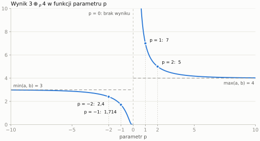
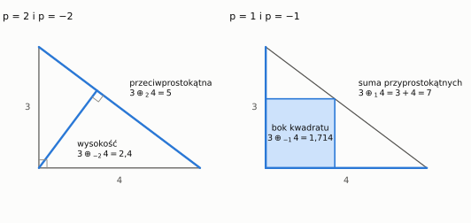
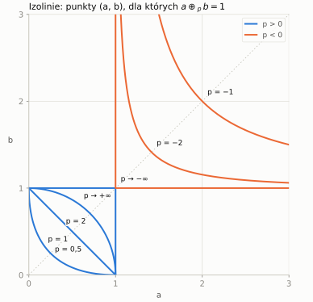
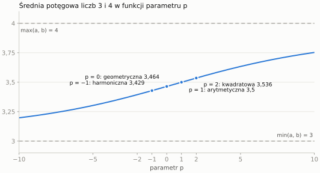

# p-dodawanie

p-dodawanie to 1 działanie z parametrem p. Działanie zastępuje osobne wzory na sumę, sumę kwadratów, połączenie równoległe, maksimum i minimum.

`a ⊕ₚ b = (a^p + b^p)^(1/p)`



> Legenda: MUSI oznacza wymóg bez wyjątków. „Albo” oznacza dokładnie 1 z członów. Znak `^` oznacza potęgę. Przecinek oddziela części dziesiętne. Znacznik `[DO USTALENIA: …]` oznacza brak danych.

## Spis treści

1. [Słownik](#1-słownik)
2. [Definicja](#2-definicja)
3. [Wybór parametru p](#3-wybór-parametru-p)
4. [Własności](#4-własności)
5. [Wizualizacje](#5-wizualizacje)
6. [Zastosowania](#6-zastosowania)
7. [Wyprowadzenia](#7-wyprowadzenia)
8. [Ograniczenia](#8-ograniczenia)
9. [Kod](#9-kod)
10. [Dalsze kroki](#10-dalsze-kroki)
11. [Źródła](#11-źródła)
12. [Decyzje i braki](#12-decyzje-i-braki)

## 1. Słownik

| Termin | Definicja | Słowa zakazane dla tego pojęcia |
|---|---|---|
| działanie | Reguła, która przypisuje 1 wynik zestawowi argumentów. | operacja, operator |
| p-dodawanie | Działanie `a ⊕ₚ b = (a^p + b^p)^(1/p)`. Nazwa robocza tego repozytorium. | p-suma, suma potęgowa |
| parametr p | Liczba rzeczywista bez jednostki, różna od 0, która wybiera wariant p-dodawania. | stopień, rząd |
| argument | Liczba dodatnia, którą p-dodawanie łączy z innymi argumentami. | składnik |
| wynik | Liczba, którą zwraca p-dodawanie. | suma |
| układ | Zespół elementów, dla którego liczysz 1 wartość zastępczą. | system |
| element | Część układu, którą opisuje 1 argument. | komponent |
| gałąź | Część wykresu wyniku dla p < 0 albo część wykresu wyniku dla p > 0. | ramię |
| izolinia | Zbiór punktów (a, b), dla których wynik ma tę samą wartość. | poziomica |
| średnia potęgowa | Liczba `((a^p + b^p)/2)^(1/p)`. | średnia uogólniona |

## 2. Definicja

`a ⊕ₚ b = (a^p + b^p)^(1/p)`

- `a`, `b`: argumenty. Każdy argument MUSI być liczbą dodatnią. Każdy argument MUSI mieć tę samą jednostkę.
- `p`: parametr p. Parametr p MUSI być liczbą rzeczywistą różną od 0. Parametr p nie ma jednostki.
- Wynik ma jednostkę argumentów.

Wzór dla n argumentów:

`x1 ⊕ₚ x2 ⊕ₚ … ⊕ₚ xn = (x1^p + x2^p + … + xn^p)^(1/p)`

- `x1`, `x2`, …, `xn`: argumenty w tej samej jednostce.
- `n`: liczba argumentów; n ≥ 2.

## 3. Wybór parametru p

Użyj p-dodawania tylko dla wielkości x, która spełnia warunek: wielkość `x^p` układu jest sumą wielkości `x^p` elementów.

Wyznacz parametr p w tej kolejności:

1. Nazwij wielkość x, którą łączysz. Przykład: współczynnik przepływu Kv zaworu.
2. Znajdź wielkość, która jest sumą po elementach układu. Przykład: spadek ciśnienia Δp na zaworach połączonych szeregowo.
3. Zapisz zależność tej wielkości od x w postaci `stała·x^p`. Przykład: `Δp = 1 bar·Q^2·Kv^(−2)`, więc p = −2.
4. Oblicz wynik: `x = x1 ⊕ₚ x2`. Przykład: `3 m³/h ⊕₋₂ 4 m³/h = 2,4 m³/h`.

Symbole w przykładzie:

- `Δp`: spadek ciśnienia na zaworze [bar].
- `Q`: przepływ wody o gęstości 1000 kg/m³ [m³/h].
- `Kv`: współczynnik przepływu zaworu [m³/h].

Jeżeli zależność z kroku 3 ma inną postać niż `stała·x^p`, to użyj ogólnego przepisu z sekcji 10.

## 4. Własności

Symbole `a`, `b`, `c` oznaczają liczby dodatnie. Każda własność ma test w pliku `test_pdodawanie.py`.

| Nr | Własność | Wzór albo opis |
|---|---|---|
| W1 | Przemienność | `a ⊕ₚ b = b ⊕ₚ a` |
| W2 | Łączność | `(a ⊕ₚ b) ⊕ₚ c = a ⊕ₚ (b ⊕ₚ c)` |
| W3 | Jednorodność | `c·(a ⊕ₚ b) = (c·a) ⊕ₚ (c·b)` |
| W4 | Ograniczenie wyniku | Dla p > 0 wynik jest większy niż max(a, b). Dla p < 0 wynik jest mniejszy niż min(a, b). |
| W5 | Monotoniczność | Na każdej gałęzi wynik maleje, gdy parametr p rośnie. |
| W6 | Granice | Dla p → +∞ wynik dąży do max(a, b). Dla p → −∞ wynik dąży do min(a, b). Dla p → 0 po stronie dodatniej wynik dąży do +∞. Dla p → 0 po stronie ujemnej wynik dąży do 0. |
| W7 | Dwoistość | `(a ⊕ₚ b)·(a ⊕₋ₚ b) = a·b` |
| W8 | Powtórzenie | n równych argumentów a daje wynik `n^(1/p)·a`. |
| W9 | Średnia potęgowa | `((a^p + b^p)/2)^(1/p) = 2^(−1/p)·(a ⊕ₚ b)` |
| W10 | Skala logarytmiczna | `ln(a ⊕ₚ b) = h·ln(e^(x/h) + e^(y/h))` dla `x = ln a`, `y = ln b`, `h = 1/p` |

Skutki własności:

- W2: zapis `a ⊕ₚ b ⊕ₚ c` nie wymaga nawiasów.
- W3: wynik nie zależy od wyboru jednostki. Przykład dla p = −2: `50 l/min ⊕ₚ 66,67 l/min = 40 l/min`, czyli `3 m³/h ⊕ₚ 4 m³/h = 2,4 m³/h`.
- W7: dla argumentów 3 i 4 zachodzi `5·2,4 = 12` (p = 2 i p = −2) oraz `7·1,714 = 12` (p = 1 i p = −1). Własność W7 obowiązuje tylko dla 2 argumentów.
- W8: 4 równe niepewności u dają `2·u` (p = 2). 2 równe rezystory R połączone równolegle dają `R/2` (p = −1).

## 5. Wizualizacje

### 5.1. Wynik w funkcji parametru p

Rysunek `img/wynik-vs-p.svg` pokazuje wynik `3 ⊕ₚ 4` dla parametru p od −10 do 10 włącznie.

- Wykres ma 2 gałęzie, bo dla p = 0 wynik nie istnieje: `a^0 + b^0 = 2`, a wykładnik `1/p` nie ma wartości.
- Gałąź p < 0 leży pod linią min(a, b) = 3. Przykład: dla p = −10 wynik wynosi 2,984.
- Gałąź p > 0 leży nad linią max(a, b) = 4. Przykład: dla p = 10 wynik wynosi 4,022.
- 4 punkty oznaczają wartości parametru p z sekcji 6: −2, −1, 1, 2.

### 5.2. Trójkąt prostokątny 3-4-5



1 trójkąt prostokątny o przyprostokątnych 3 i 4 pokazuje wynik dla 4 wartości parametru p.

| Parametr p | Odcinek w trójkącie | Wynik `3 ⊕ₚ 4` | Źródło |
|---|---|---|---|
| 2 | przeciwprostokątna | 5 | [S2] |
| 1 | suma przyprostokątnych | 7 | obliczenie |
| −1 | bok kwadratu wpisanego, który ma wierzchołek w kącie prostym | 1,714 | obliczenie: `s/4 + s/3 = 1` |
| −2 | wysokość opuszczona na przeciwprostokątną | 2,4 | [S3] |

### 5.3. Izolinie



Rysunek pokazuje punkty (a, b), dla których `a ⊕ₚ b = 1`.

- Dla p > 0 każda izolinia łączy punkt (1; 0) z punktem (0; 1). Dla p = 1 izolinia jest odcinkiem. Dla p = 2 izolinia jest ćwiartką okręgu.
- Dla p < 0 każda izolinia ma 2 asymptoty: a = 1 oraz b = 1. Dla p = −1 izolinia jest gałęzią hiperboli `(a − 1)·(b − 1) = 1`.
- Dla p → +∞ izolinia dąży do łamanej z wierzchołkiem (1; 1), która leży w kwadracie jednostkowym. Dla p → −∞ izolinia dąży do łamanej z wierzchołkiem (1; 1), która leży poza kwadratem jednostkowym.
- Izolinia dla p > 0 jest ćwiartką superelipsy [S15].

### 5.4. Średnia potęgowa



Średnia potęgowa różni się od wyniku p-dodawania czynnikiem `2^(−1/p)` (własność W9). Ten czynnik usuwa przerwę wykresu w punkcie p = 0. Dla p = 0 średnia potęgowa ma wartość granicy, czyli średnią geometryczną [S10].

| Parametr p | Nazwa średniej | Wartość dla liczb 3 i 4 |
|---|---|---|
| −1 | harmoniczna | 3,429 |
| 0 | geometryczna | 3,464 |
| 1 | arytmetyczna | 3,5 |
| 2 | kwadratowa | 3,536 |

### 5.5. Strona interaktywna

Plik `demo.html` zawiera 3 części:

1. Wykres wyniku w funkcji parametru p z suwakami a, b, p.
2. Izolinię przez punkt (a, b). Dla p > 0 izolinia przecina każdą oś w punkcie równym wynikowi. Dla p < 0 wynik wyznacza 2 asymptoty izolinii.
3. Kalkulator 15 zastosowań z jednostkami.

Plik `demo.html` nie pobiera danych z sieci. Sekcja 9 podaje polecenie, które otwiera plik.

## 6. Zastosowania

### 6.1. Zastosowania potwierdzone w źródłach

| Parametr p | Argumenty i wynik | Wzór | Przykład | Źródło |
|---|---|---|---|---|
| 2 | Przyprostokątne trójkąta prostokątnego. Wynik: przeciwprostokątna. | `c = a ⊕₂ b` | 3 mm i 4 mm dają 5 mm | [S2] |
| 2 | Niepewności standardowe 2 nieskorelowanych wielkości. Wynik: niepewność standardowa sumy. | `u = u1 ⊕₂ u2` | 3 mm i 4 mm dają 5 mm | [S5] |
| 2 | Odchylenia standardowe 2 niezależnych zmiennych losowych. Wynik: odchylenie standardowe sumy. | `σ = σ1 ⊕₂ σ2` | 3 s i 4 s dają 5 s | [S2] |
| 2 | Tolerancje 2 niezależnych wymiarów. Wynik: tolerancja sumy wymiarów. | `t = t1 ⊕₂ t2` | 0,03 mm i 0,04 mm dają 0,05 mm | [S2] |
| 2 | Wartości skuteczne 2 niespójnych sygnałów. Wynik: wartość skuteczna sumy. | `U = U1 ⊕₂ U2` | 1 V i 1 V dają 1,414 V | [S9] |
| 2 | Iloczyn pędu i prędkości światła oraz energia spoczynkowa. Wynik: energia całkowita. | `E = (pęd·c) ⊕₂ (m·c^2)` | 3 MeV i 4 MeV dają 5 MeV | [S2] |
| 1 | Współczynniki Kv 2 zaworów połączonych równolegle. Wynik: Kv układu. | `Kv = Kv1 ⊕₁ Kv2` | 3 m³/h i 4 m³/h dają 7 m³/h | [S4] |
| −0,5 | Opory `k` 2 gałęzi równoległych o charakterystyce `Δp = k·Q^2`. Wynik: opór układu. | `k = k1 ⊕ₚ k2` | 8 bar/(m³/h)² i 8 bar/(m³/h)² dają 2 bar/(m³/h)² | [S6] |
| −1 | Rezystancje 2 rezystorów połączonych równolegle. Wynik: rezystancja układu. | `R = R1 ⊕₋₁ R2` | 6 Ω i 3 Ω dają 2 Ω | [S1] |
| −1 | Pojemności 2 kondensatorów połączonych szeregowo. Wynik: pojemność układu. | `C = C1 ⊕₋₁ C2` | 6 µF i 3 µF dają 2 µF | [S1] |
| −1 | Czasy, w których 2 wykonawców wykonuje tę samą pracę osobno. Wynik: czas pracy wspólnej. | `T = T1 ⊕₋₁ T2` | 5 h i 7 h dają 2,92 h | [S1] |
| −1 | Masy 2 ciał. Wynik: masa zredukowana. | `μ = m1 ⊕₋₁ m2` | 2 kg i 3 kg dają 1,2 kg | [S1] |
| −1 | Odległość przedmiotu i odległość obrazu rzeczywistego. Wynik: ogniskowa soczewki cienkiej. | `f = x ⊕₋₁ y` | 300 mm i 150 mm dają 100 mm | [S1] |
| −1 | Fizyczny okres półtrwania i biologiczny okres półtrwania. Wynik: efektywny okres półtrwania. | `T = Tf ⊕₋₁ Tb` | 8 d i 21 d dają 5,79 d | [S8] |
| −2 | Współczynniki Kv 2 zaworów połączonych szeregowo. Wynik: Kv układu. | `Kv = Kv1 ⊕₋₂ Kv2` | 3 m³/h i 4 m³/h dają 2,4 m³/h | [S4] |
| −2 | Przyprostokątne trójkąta prostokątnego. Wynik: wysokość opuszczona na przeciwprostokątną. | `h = a ⊕₋₂ b` | 3 mm i 4 mm dają 2,4 mm | [S3] |
| −2 | Odległości 2 jednakowych lamp punktowych od ekranu. Wynik: odległość 1 lampy, która daje równe natężenie oświetlenia. | `d = d1 ⊕₋₂ d2` | 3 m i 4 m dają 2,4 m | [S3] |

### 6.2. Zastosowania wyprowadzone w tym pliku

Sekcja 7 zawiera wyprowadzenie dla każdego wiersza.

| Parametr p | Argumenty i wynik | Przykład | Wyprowadzenie |
|---|---|---|---|
| 2 | Średnice wewnętrzne 2 rur. Wynik: średnica 1 rury o równym polu przekroju. | 20 mm i 20 mm dają 28,28 mm | D1 |
| 2,5 | Średnice wewnętrzne 2 rur równoległych. Wynik: średnica 1 rury o równym spadku ciśnienia w przepływie burzliwym. | 20 mm i 20 mm dają 26,39 mm | D2 |
| 4 | Średnice wewnętrzne 2 rur równoległych. Wynik: średnica 1 rury o równym spadku ciśnienia w przepływie laminarnym. | 20 mm i 20 mm dają 23,78 mm | D3 |
| 3 | Promienie 2 kropli. Wynik: promień kropli po połączeniu. | 1 mm i 1 mm dają 1,26 mm | D4 |
| −1 | Sztywności 2 sprężyn połączonych szeregowo. Wynik: sztywność układu. | 6 N/mm i 3 N/mm dają 2 N/mm | D5 |
| −2 | Współczynniki Kv 2 zaworów połączonych szeregowo. Wynik: Kv układu. | 3 m³/h i 4 m³/h dają 2,4 m³/h | D6 |

### 6.3. Uogólnienia

| Nazwa | Wzór | Związek z p-dodawaniem | Źródło |
|---|---|---|---|
| Średnia potęgowa | `M = ((x1^p + … + xn^p)/n)^(1/p)` | Wynik p-dodawania pomnożony przez `n^(−1/p)`. | [S10] |
| Funkcja CES w ekonomii | `Q = F·(a·K^ρ + (1 − a)·L^ρ)^(ν/ρ)` | p-dodawanie z wagami. Parametr ρ pełni rolę parametru p. | [S11] |
| Warstwa GeM w sieciach neuronowych | `f = ((x1^p + … + xn^p)/n)^(1/p)` | Średnia potęgowa. Sieć dobiera parametr p w czasie treningu. | [S12] |
| t-konorma Yagera w logice rozmytej | `S(a, b) = min((a^p + b^p)^(1/p), 1)` | Wynik p-dodawania ograniczony do wartości co najwyżej 1. | [S13] |
| Norma p jako gładkie maksimum | `(x1^p + … + xn^p)^(1/p)` | p-dodawanie dla p ≥ 1. Dla p → +∞ wynik dąży do maksimum. | [S14] |
| Superelipsa | `(x/a)^n + (y/b)^n = 1` dla x ≥ 0 i y ≥ 0 | Izolinia p-dodawania dla p = n i dla argumentów `x/a` oraz `y/b`. | [S15] |

Funkcja CES ma 3 przypadki graniczne [S11]:

- Dla ρ = 1 funkcja CES jest liniowa.
- Dla ρ → 0 funkcja CES dąży do funkcji Cobba–Douglasa.
- Dla ρ → −∞ funkcja CES dąży do funkcji Leontiefa, czyli do minimum.

### 6.4. Propozycje zastosowań

Każda pozycja tej listy to propozycja tego repozytorium bez źródła.

1. Arkusz kalkulacyjny ma 1 funkcję `padd` zamiast osobnych wzorów z tabeli 6.1.
2. Funkcja `dopasuj_p` rozpoznaje prawo z pomiaru. Przykład: 2 rury 20 mm i rura zastępcza 26,39 mm dają p = 2,5, czyli przepływ burzliwy z wyprowadzenia D2.
3. Własność W4 sprawdza wynik obliczeń. Jeżeli wynik dla p < 0 jest większy niż min(a, b), to obliczenie zawiera błąd.
4. Własność W7 sprawdza 2 wyniki naraz. Przykład: rezystancja szeregowa pomnożona przez rezystancję równoległą MUSI dać `R1·R2`.
5. Nauczyciel pokazuje na 1 wykresie minimum, połączenie równoległe, sumę, twierdzenie Pitagorasa i maksimum.

## 7. Wyprowadzenia

**D1. Równe pole przekroju (p = 2).** Pole przekroju rury wynosi `A = π·d^2/4`. Pole przekroju rury zastępczej jest sumą pól przekroju 2 rur. Wynik: `d^2 = d1^2 + d2^2`.

**D2. Rury równoległe, przepływ burzliwy (p = 2,5).** Wzór Darcy’ego–Weisbacha daje `Δp = stała·λ·L·Q^2/d^5` [S6]. Rury równoległe mają wspólny spadek ciśnienia Δp. Przepływ układu jest sumą przepływów rur. Dla równej długości L i równego współczynnika tarcia λ zachodzi `Q = stała·d^(5/2)` [S7]. Wynik: `d^(5/2) = d1^(5/2) + d2^(5/2)`.

**D3. Rury równoległe, przepływ laminarny (p = 4).** Prawo Hagena–Poiseuille’a daje `Q = π·d^4·Δp/(128·μ·L)` [S6]. Dla wspólnego spadku ciśnienia Δp i równej długości L przepływ Q jest proporcjonalny do `d^4`. Wynik: `d^4 = d1^4 + d2^4`.

**D4. Połączenie 2 kropli (p = 3).** Objętość kropli wynosi `V = (4/3)·π·r^3`. Objętość kropli po połączeniu jest sumą objętości 2 kropli. Wynik: `r^3 = r1^3 + r2^3`.

**D5. Sprężyny połączone szeregowo (p = −1).** 2 sprężyny połączone szeregowo przenoszą tę samą siłę F. Wydłużenie układu `F/k` jest sumą wydłużeń sprężyn. Wynik: `1/k = 1/k1 + 1/k2`.

**D6. Zawory połączone szeregowo (p = −2).** Zawór daje spadek ciśnienia `Δp = 1 bar·(Q/Kv)^2` dla wody o gęstości 1000 kg/m³. Zawory połączone szeregowo mają wspólny przepływ Q. Spadek ciśnienia układu jest sumą spadków ciśnienia zaworów. Wynik: `Kv^(−2) = Kv1^(−2) + Kv2^(−2)`, zgodnie ze źródłem [S4].

Symbole w wyprowadzeniach:

- `d`: średnica wewnętrzna rury [mm]. `L`: długość rury [m]. `λ`: współczynnik tarcia, bez jednostki.
- `Q`: przepływ [m³/h]. `Δp`: spadek ciśnienia [bar]. `μ`: lepkość dynamiczna [Pa·s].
- `r`: promień kropli [mm]. `k`: sztywność sprężyny [N/mm]. `F`: siła [N].

## 8. Ograniczenia

- Każdy argument MUSI być liczbą dodatnią. Każdy argument MUSI mieć tę samą jednostkę.
- Parametr p MUSI być różny od 0.
- Wartość p = 2 dla niepewności obowiązuje tylko dla wielkości nieskorelowanych. Dla wielkości skorelowanych źródło [S5] podaje wzór z kowariancją.
- Wartość p = 2 dla sygnałów obowiązuje tylko dla sygnałów niespójnych. Amplitudy 2 sygnałów spójnych o zgodnej fazie mają p = 1 [S9].
- Wartość p = 2,5 dla rur wymaga równego współczynnika tarcia λ w każdej rurze. Wyprowadzenie D2 pomija zależność λ od średnicy. Błąd wyniku: `[DO USTALENIA: zależy od instalacji]`.
- Wartość p = −2 dla zaworów wymaga zależności `Δp = 1 bar·(Q/Kv)^2`.
- Wartość p = −2 dla lamp wymaga modelu lampy punktowej. Wzór pomija kąt padania światła.
- Własność W7 obowiązuje tylko dla 2 argumentów.
- Dla p = 0 średnia potęgowa ma wartość `(a·b)^(1/2)`, a wynik p-dodawania nie istnieje.

## 9. Kod

| Plik | Zawartość |
|---|---|
| `pdodawanie.py` | Funkcje `padd`, `srednia_potegowa`, `dopasuj_p`. Plik korzysta tylko z biblioteki standardowej Pythona. |
| `test_pdodawanie.py` | 39 testów: każdy przykład liczbowy z tego pliku i każda własność W1–W10. |
| `rysunki.py` | Skrypt, który zapisuje 4 rysunki SVG w katalogu `img`. Skrypt wymaga bibliotek matplotlib i numpy. |
| `demo.html` | Strona interaktywna z sekcji 5.5. |

39 testów przeszło 2026-11-12 w Pythonie 3.13.18 z biblioteką pytest 9.1.1.

### 9.1. Funkcje

| Funkcja | Wynik |
|---|---|
| `padd(x1, x2, …, p=p)` | Wynik p-dodawania dla co najmniej 2 argumentów. Dla `p=float("inf")` funkcja zwraca maksimum. Dla `p=float("-inf")` funkcja zwraca minimum. |
| `srednia_potegowa(x1, x2, …, p=p)` | Średnia potęgowa. Dla `p=0` funkcja zwraca średnią geometryczną. |
| `dopasuj_p(a, b, c)` | Parametr p, dla którego `a ⊕ₚ b = c`. Rozwiązanie istnieje tylko dla c > max(a, b) albo dla c < min(a, b). |

```python
from pdodawanie import padd, dopasuj_p

padd(3, 4, p=2)             # 5.0
padd(6, 3, p=-1)            # 2.0
padd(3, 4, 12, p=2)         # 13.0
dopasuj_p(20, 20, 26.39)    # 2.5 po zaokrągleniu do 3 miejsc po przecinku
```

### 9.2. Polecenia

Wykonaj każde polecenie w katalogu `p-dodawanie`.

Oblicz `3 ⊕₋₂ 4`:

```bash
python3 pdodawanie.py -2 3 4
```

Wynik: `2.4`.

Rozbicie:

- `python3`: uruchamia interpreter Pythona 3.
- `pdodawanie.py`: plik, który interpreter wykonuje.
- `-2`: parametr p. Parametr p stoi przed argumentami.
- `3 4`: argumenty. Polecenie przyjmuje co najmniej 2 argumenty.

Uruchom testy:

```bash
python3 -m pytest -q
```

Wynik: `39 passed`.

Rozbicie:

- `-m pytest`: uruchamia moduł pytest, który wykonuje każdy test z pliku `test_pdodawanie.py`.
- `-q`: skraca raport do 1 znaku na test i 1 wiersza podsumowania.

Zapisz rysunki od nowa:

```bash
python3 rysunki.py
```

Rozbicie:

- `rysunki.py`: skrypt, który zapisuje 4 pliki SVG w katalogu `img`.

Otwórz stronę interaktywną w systemie Linux:

```bash
xdg-open demo.html
```

Rozbicie:

- `xdg-open`: otwiera plik w domyślnej aplikacji systemu, czyli w przeglądarce.
- `demo.html`: plik strony interaktywnej.

## 10. Dalsze kroki

### 10.1. Ogólny przepis

`a ⊕ b = f⁻¹(f(a) + f(b))`

- `f`: funkcja ciągła i ściśle monotoniczna.
- `f⁻¹`: funkcja odwrotna do funkcji f.

p-dodawanie powstaje z tego przepisu dla `f(x) = x^p`. Mnożenie powstaje dla `f(x) = ln x`, bo `a·b = e^(ln a + ln b)`.

Twierdzenie Aczéla opisuje każde działanie, które spełnia 4 warunki [S16]:

1. Działanie łączy liczby z przedziału liczb rzeczywistych, który jest otwarty z co najmniej 1 strony.
2. Działanie jest ciągłe.
3. Działanie jest łączne.
4. Działanie jest ściśle rosnące względem każdego argumentu.

Każde takie działanie ma postać z ogólnego przepisu dla co najmniej 1 funkcji f [S16]. Maksimum i minimum są ciągłe i łączne, ale nie mają tej postaci [S17]. Dlatego maksimum i minimum są tylko granicami p-dodawania (własność W6).

### 10.2. Kandydat na następne działanie

Własność W10 łączy p-dodawanie z działaniem na skali logarytmicznej:

`x ⊞ₕ y = h·ln(e^(x/h) + e^(y/h))`

- `x`, `y`: liczby rzeczywiste w tej samej jednostce, np. poziomy w decybelach.
- `h`: parametr w jednostce liczb x i y; h ≠ 0.

Dla h = 1 wzór opisuje dodawanie w półpierścieniu logarytmicznym [S18]. Przykłady zastosowań z [S18] (lista niepełna): decybele, logarytmy prawdopodobieństw.

## 11. Źródła

- [S1] Wikipedia, „Parallel (operator)”: https://en.wikipedia.org/wiki/Parallel_(operator)
- [S2] Wikipedia, „Pythagorean addition”: https://en.wikipedia.org/wiki/Pythagorean_addition
- [S3] Wikipedia, „Inverse Pythagorean theorem”: https://en.wikipedia.org/wiki/Inverse_Pythagorean_theorem
- [S4] The Engineering ToolBox, „Control Valves - Adding Flow Coefficients for Valves in Series or Parallel”: https://engineeringtoolbox.com/adding-kv-cv-d_1120.html
- [S5] JCGM 100:2008, „Evaluation of measurement data — Guide to the expression of uncertainty in measurement”, rozdział 5: https://users.physics.ox.ac.uk/~palmerc/Datafiles/BIPM.pdf
- [S6] EngineeringHulk, „Pipe Flow & Head Losses — Darcy-Weisbach Equation”: https://engineeringhulk.com/civil/fluid-mechanics-hydraulics/pipe-flow-losses/
- [S7] H. Cho, „Pipes in parallel”, New Mexico State University: https://here.isnew.info/u/pipes-in-parallel
- [S8] Wikipedia, „Effective half-life”: https://en.wikipedia.org/wiki/Effective_half-life
- [S9] E. Sengpiel, „Adding amplitudes (and levels)”: https://sengpielaudio.com/calculator-leveladding.htm
- [S10] Wikipedia, „Generalized mean”: https://en.wikipedia.org/wiki/Generalized_mean
- [S11] Wikipedia, „Constant elasticity of substitution”: https://en.wikipedia.org/wiki/Constant_elasticity_of_substitution
- [S12] F. Radenović, G. Tolias, O. Chum, „Fine-tuning CNN Image Retrieval with No Human Annotation”: https://arxiv.org/abs/1711.02512v2
- [S13] „Analyzing Differentiable Fuzzy Logic Operators”, rozdział 7.3: https://arxiv.org/pdf/2002.06100
- [S14] Wikipedia, „Smooth maximum”: https://en.wikipedia.org/wiki/Smooth_maximum
- [S15] Wikipedia, „Superellipse”: https://en.wikipedia.org/wiki/Superellipse
- [S16] Wikipedia, „Associativity equation”: https://en.wikipedia.org/wiki/Associativity_equation
- [S17] M. Bajger, J. Brzdęk, E. El-hady, E. Jabłońska, „On the Continuous Cancellative Semigroups on a Real Interval and on a Circle and Some Symmetry Issues”: https://www.mdpi.com/2073-8994/12/12/1974
- [S18] Wikipedia, „Log semiring”: https://en.wikipedia.org/wiki/Log_semiring

## 12. Decyzje i braki

| Nr | Fragment | Znaczenia albo brak | Wybór |
|---|---|---|---|
| 1 | Nazwa „p-dodawanie” i znak `⊕ₚ` | Źródła [S1] i [S2] nazywają tylko przypadki p = −1 i p = 2. | Nazwa robocza tego repozytorium. |
| 2 | Zakres argumentów | Wzór ma wartość także dla argumentu 0 przy p > 0. | Kod przyjmuje tylko argumenty dodatnie. |
| 3 | Błąd wyniku dla p = 2,5 | Brak liczby. | `[DO USTALENIA: zależy od instalacji]` |
| 4 | Wersja Pythona | Testy przeszły tylko w wersji 3.13.18. | `[DO USTALENIA: inne wersje]` |
| 5 | Licencja | Repozytorium nie ma pliku z licencją. | `[DO USTALENIA: licencję wybiera właściciel repozytorium]` |
| 6 | Sekcja 6.4 | Brak źródła dla każdej pozycji. | Każda pozycja ma oznaczenie „propozycja”. |
| 7 | Przykłady liczbowe | Źródła podają wzory. Liczby w przykładach pochodzą z testów. | Każdy przykład ma test w pliku `test_pdodawanie.py`. |
